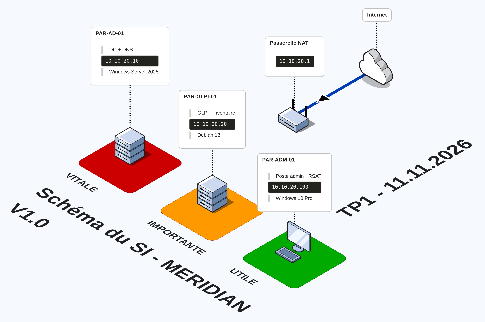

# TP1 - Construire le lab, inventorier et cartographier MERIDIAN

AIS - RNCP 37680 - CP1 - Appliquer les bonnes pratiques dans l'administration des infrastructures

Auteur : Zishan | Date : 11/11/2026 | Version : 1.0

## Contexte

MERIDIAN Systèmes (180 salariés, sites de Paris et Lyon) ne dispose d'aucun inventaire fiable de son parc. Le but du TP est de monter un environnement de test, d'y déployer GLPI pour inventorier automatiquement les machines, puis de classer les éléments par criticité et de cartographier le système d'information.

Le lab repose sur un réseau NAT VirtualBox `MERIDIAN` en 10.10.20.0/24, sans DHCP, avec un domaine Active Directory `meridian.lan`.

## Schéma d'ensemble du SI



Vue isométrique du SI : le contrôleur de domaine (vital), le serveur GLPI (important) et le poste d'administration (utile), reliés au réseau MERIDIAN et à Internet via la passerelle NAT. Les couleurs reprennent directement les niveaux de criticité.

## Environnement

- Hyperviseur : VirtualBox, réseau NAT nommé MERIDIAN (10.10.20.0/24, sans DHCP, passerelle 10.10.20.1)
- Domaine : meridian.lan (NetBIOS MERIDIAN)
- Résolution de noms : assurée par le DC (10.10.20.10), avec forwarders 1.1.1.1 et 9.9.9.9 pour l'externe

## 1. Fiche d'installation des machines

(sans mot de passe, conformément à la consigne)

| Machine | Rôle | Système | Ressources | IP | Comptes créés |
|---|---|---|---|---|---|
| PAR-AD-01 | Contrôleur de domaine + DNS | Windows Server 2025 Standard (Évaluation) | 2 vCPU / 3 Go / 60 Go | 10.10.20.10 | Administrateur du domaine, compte DSRM |
| PAR-GLPI-01 | Serveur GLPI (inventaire et centre de services) | Debian 13 (trixie) | 1 vCPU / 2 Go / 20 Go | 10.10.20.20 | root, utilisateur local, utilisateur base `glpi` |
| PAR-ADM-01 | Poste d'administration (RSAT) | Windows 10 Pro 22H2 | 2 vCPU / 4 Go / 64 Go | 10.10.20.100 | compte local admin, connexion domaine |

Remarque : le poste d'administration est en Windows 10 Pro au lieu de Windows 11 Entreprise prévu par le TP. Écart assumé, fonctionnellement équivalent pour le périmètre (jonction au domaine et RSAT).

Points techniques :

- DNS de PAR-GLPI-01 pointé sur le DC via `/etc/resolv.conf`, verrouillé avec `chattr +i` pour éviter sa réécriture au reboot.
- `glpi.meridian.lan` est un CNAME vers `par-glpi-01.meridian.lan` (créé par le script d'init du lab).
- Vhost Apache avec `DocumentRoot /var/www/glpi/public` (GLPI 11 n'expose que le dossier public).

## 2. Captures

Get-ADDomain lancé depuis PAR-ADM-01 (administration de l'AD depuis le poste dédié) :


Page d'accueil GLPI (installation terminée, comptes par défaut sécurisés, données de démo désactivées) :


Liste des ordinateurs inventoriés, Parc > Ordinateurs (les 3 machines) :


## 3. Inventaire de l'Active Directory (script et CSV)

Script : [`scripts/Inventaire-Serveurs.ps1`](scripts/Inventaire-Serveurs.ps1)
Résultats : [`data/serveurs.csv`](data/serveurs.csv) et [`data/comptes-inactifs.csv`](data/comptes-inactifs.csv)

```powershell
# Inventaire des serveurs
New-Item -ItemType Directory -Path C:\Inventaire -Force | Out-Null
$serveurs = Get-ADComputer -Filter 'OperatingSystem -like "*Server*"' -Properties OperatingSystem, LastLogonDate
$inventaire = foreach ($s in $serveurs) {
    $os = Get-CimInstance Win32_OperatingSystem -ComputerName $s.Name -ErrorAction SilentlyContinue
    [PSCustomObject]@{
        Nom = $s.Name; Systeme = $s.OperatingSystem; Version = $os.Version
        DernierBoot = $os.LastBootUpTime; DerniereConn = $s.LastLogonDate
    }
}
$inventaire | Export-Csv C:\Inventaire\serveurs.csv -NoTypeInformation -Encoding UTF8

# Comptes ordinateurs inactifs depuis 90 jours
$seuil = (Get-Date).AddDays(-90)
$inactifs = Get-ADComputer -Filter * -Properties LastLogonDate, OperatingSystem |
    Where-Object { -not $_.LastLogonDate -or $_.LastLogonDate -lt $seuil } |
    Select-Object Name, OperatingSystem, LastLogonDate
$inactifs | Export-Csv C:\Inventaire\comptes-inactifs.csv -NoTypeInformation -Encoding UTF8
```

Résultat : seul PAR-AD-01 répond réellement. PAR-FS-01 (Server 2016) et LYO-SRV-01 (Server 2012 R2) sont des comptes présents dans l'AD sans machine derrière. Les comptes jamais connectés ou inactifs depuis plus de 90 jours sont PAR-FS-01, LYO-SRV-01, PAR-PC-017 et LYO-PC-004.

## 4. Tableau de criticité

| Élément | Responsable | Criticité | Données traitées | Exposition |
|---|---|---|---|---|
| PAR-AD-01 | Équipe infrastructure | Vitale | Identités, authentification, DNS | Interne, cœur du domaine ; sa perte paralyse tout le SI |
| PAR-GLPI-01 | Équipe infrastructure | Importante | Inventaire du parc, tickets | Interne (intranet web) ; perte gênante mais non bloquante pour l'authentification |
| PAR-ADM-01 | Administrateur système | Utile | Outils d'administration (RSAT), scripts | Interne, poste de travail, remplaçable |

## 5. Fiche d'identité du système d'information

Sites : Paris (siège) et Lyon.

Effectifs : 180 salariés.

Serveurs : PAR-AD-01 (contrôleur de domaine et DNS, Windows Server 2025), seul serveur réellement en service. L'AD référence aussi PAR-FS-01 (Server 2016) et LYO-SRV-01 (Server 2012 R2), sans machine associée.

Services critiques : Active Directory (authentification), DNS, et GLPI (inventaire et gestion des services).

Points faibles relevés :

- LYO-SRV-01 tourne sous Windows Server 2012 R2, en fin de support, à décommissionner.
- Plusieurs comptes ordinateurs obsolètes, jamais connectés, traînent dans l'AD (PAR-FS-01, PAR-PC-017, LYO-PC-004).
- Le jeu de données contient volontairement de mauvaises pratiques : un compte `admin` partagé et un compte de service à mot de passe permanent, à corriger au TP4.
- Poste d'administration en Windows 10 Pro au lieu de Windows 11 Entreprise.

## Réponses aux questions

### 3.1 - Pourquoi administrer l'AD depuis un poste dédié plutôt que sur le DC ?

J'ai installé RSAT sur PAR-ADM-01 pour gérer l'AD, le DNS et les GPO à distance, sans jamais ouvrir de session sur le contrôleur de domaine. Ouvrir des sessions directement sur un DC l'expose : des identifiants d'administration restent en mémoire et peuvent être récupérés, et le moindre programme ou la moindre erreur touche directement le cœur du domaine. En passant par un poste dédié, je garde le DC concentré sur son seul rôle et je limite la surface d'attaque. C'est le principe du moindre privilège et de la séparation des rôles.

### 4.1 - Pourquoi changer les mots de passe des comptes par défaut avant toute autre action ?

Dès la fin de l'installation, j'ai changé les mots de passe des comptes par défaut de GLPI (glpi, tech, normal, post-only). Ces identifiants sont publics et connus de tout le monde. Tant qu'ils ne sont pas changés, n'importe qui atteignant l'interface peut se connecter, et avec glpi/glpi il arrive même en super-administrateur. C'est la première chose qu'un attaquant teste, donc je les sécurise avant que le service soit réellement utilisé.

### 5.1 - Comment déployer l'agent sur les 180 postes sans passer sur chaque machine ?

Passer à la main sur 180 postes n'est pas réaliste. Je déploierais l'agent GLPI via une GPO qui installe le paquet MSI au démarrage des machines du domaine. Selon l'outillage déjà en place, une solution comme SCCM, PDQ Deploy ou Ansible ferait aussi l'affaire. L'objectif est un déploiement silencieux et centralisé sur tout le parc.

### 6.1 - Quels écarts entre l'AD et GLPI, et que proposer ?

En comparant mon inventaire AD avec la liste GLPI, je constate que l'AD contient des comptes sans machine réelle et jamais connectés (PAR-FS-01, LYO-SRV-01, PAR-PC-017, LYO-PC-004), absents de GLPI. À l'inverse, par-glpi-01 (Linux non joint au domaine) est dans GLPI mais n'a pas de compte AD. Je propose de nettoyer ou désactiver les comptes obsolètes, de décommissionner LYO-SRV-01 qui est en fin de support, et de rapprocher régulièrement les deux inventaires pour détecter les dérives.

## Difficultés rencontrées

- Le poste d'administration de départ était en Windows 11 Home, qui ne peut pas rejoindre un domaine. La bascule vers Pro a d'abord échoué (erreur 0x8000ffff). Je l'ai résolue avec `sfc /scannow` puis `DISM /Online /Cleanup-Image /RestoreHealth`, avant de relancer `changepk`. J'ai finalement basculé sur un clone Windows 10 Pro, plus stable.
- L'écran de connexion Windows était en QWERTY alors que je tapais en AZERTY, ce qui faisait échouer les mots de passe (Win + Espace pour basculer la disposition).
- Sur la Debian, `/etc/resolv.conf` repartait tout seul sur 127.0.0.1 après chaque reboot (un résolveur local), ce qui cassait apt avec des erreurs de résolution DNS. Je l'ai repointé sur le DC puis verrouillé avec `chattr +i`.
- L'agent GLPI sous Windows ne remontait pas toujours au premier inventaire. Il a fallu forcer l'exécution avec `glpi-agent --force` depuis une invite cmd.

## Structure du dépôt

```text
INSIAC/
└── TP1/
    ├── README.md
    ├── captures/
    │   ├── tp1screen01-get-addomain.png
    │   ├── tp1screen02-accueil-glpi.png
    │   └── tp1screen03-inventaire.png
    ├── scripts/
    │   └── Inventaire-Serveurs.ps1
    ├── data/
    │   ├── serveurs.csv
    │   └── comptes-inactifs.csv
    └── schema/
        └── fossflowtp1v1.png
```
