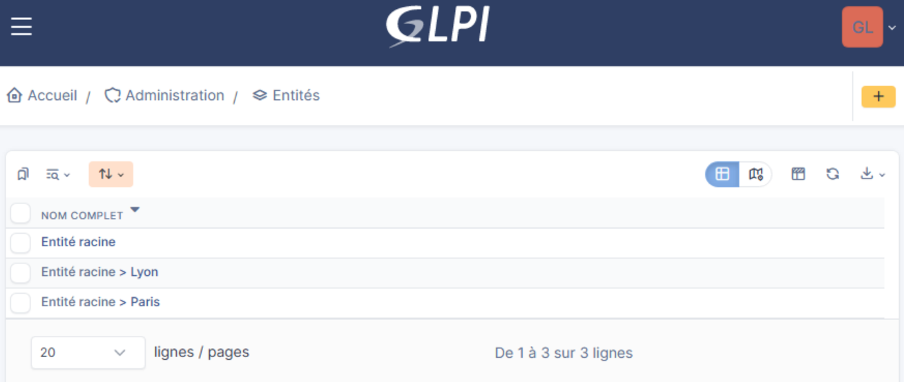
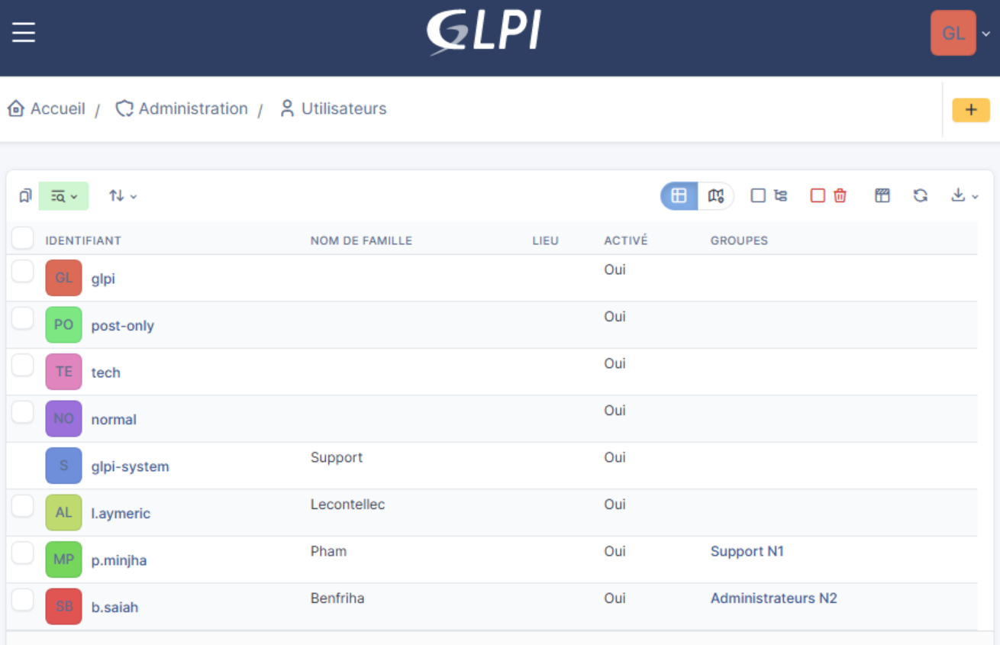
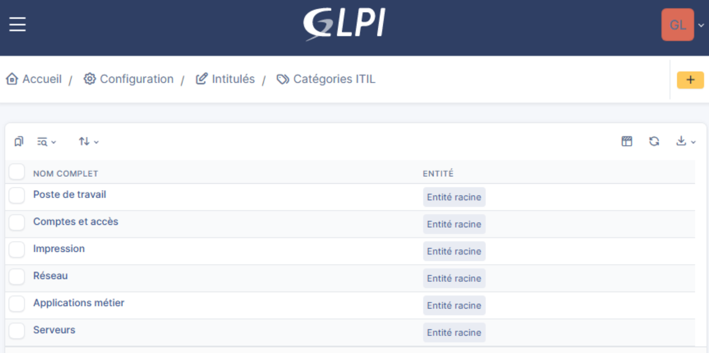
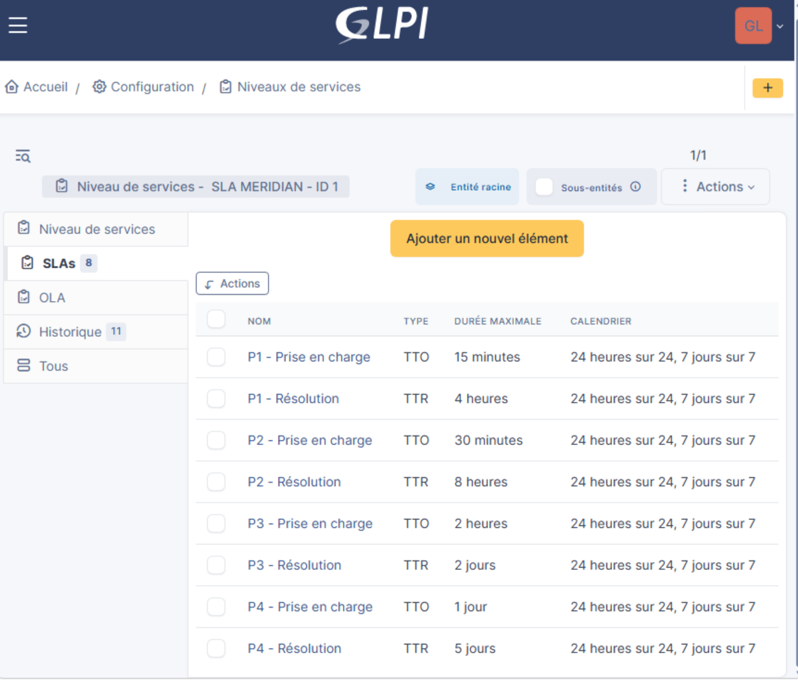
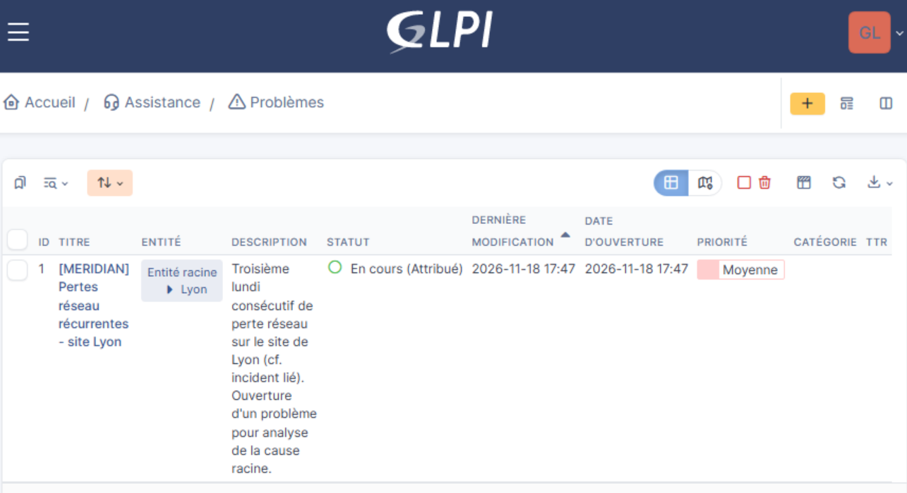
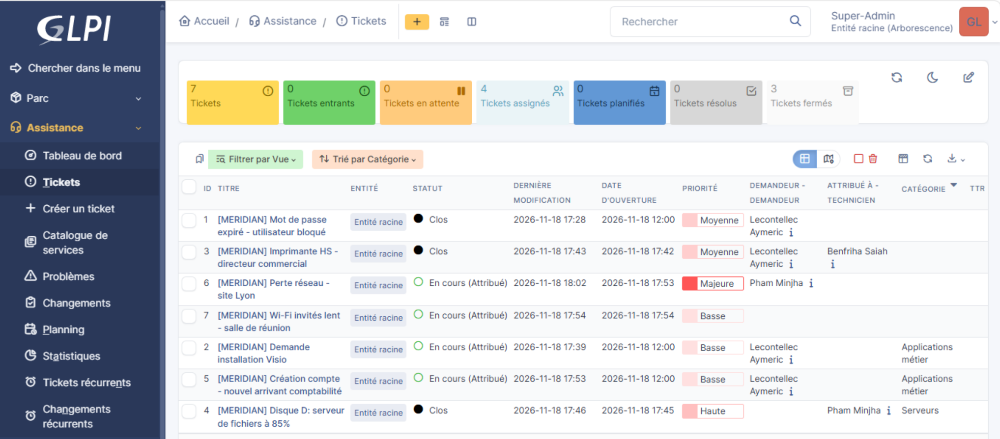
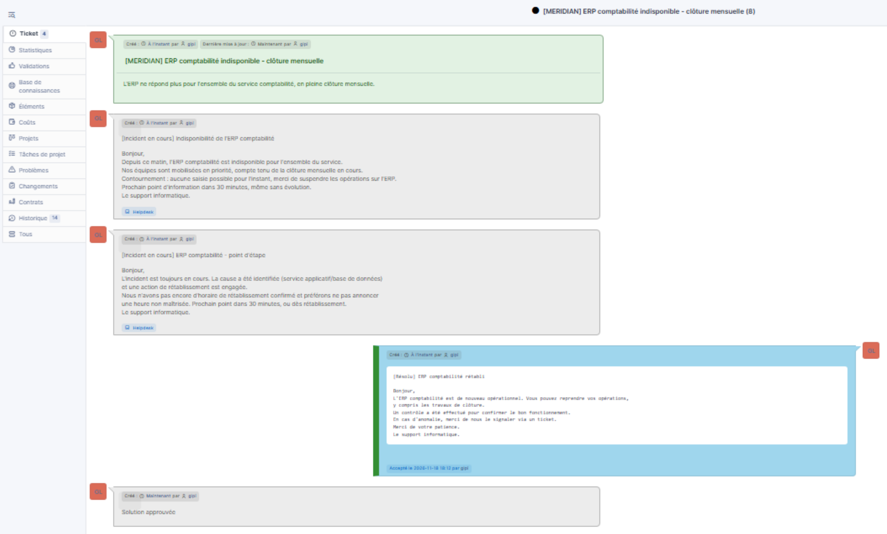
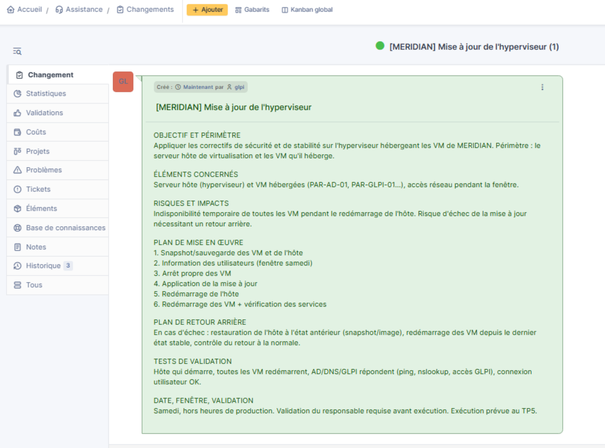
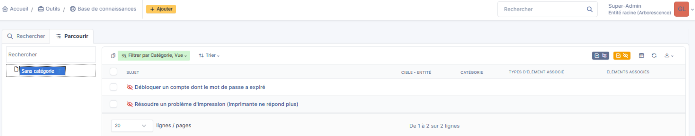

# TP2 - Monter le centre de services de MERIDIAN

AIS - RNCP37680 - CP1 - Appliquer les bonnes pratiques dans l'administration des infrastructures
Auteur : ASLAM Zishan - Date : 18/11/2026 - GLPI 11 sur PAR-GLPI-01 (10.10.20.20)

Objectif : paramétrer GLPI comme centre de services, qualifier et traiter des sollicitations, gérer un incident majeur et une demande de changement, puis capitaliser.

---

## Exercice 1 - Structurer GLPI

J'ai transformé le GLPI du TP1 (qui ne servait qu'à l'inventaire) en vrai centre de services.

### Entités
Deux entités créées sous l'entité racine, pour les deux sites de MERIDIAN :
- Paris
- Lyon

### Groupes et comptes de test
Deux groupes pour la chaîne de support N1 / N2, et trois comptes de test reproduisant les rôles réels :

| Identifiant | Profil | Groupe | Rôle |
|---|---|---|---|
| l.aymeric | Self-Service | aucun | Utilisateur qui ouvre des tickets |
| p.minjha | Technician | Support N1 | Technicien de traitement N1 |
| b.saiah | Admin | Administrateurs N2 | Escalade N2 |

### Catégories ITIL
Six catégories de tickets créées : Poste de travail, Comptes et accès, Impression, Réseau, Applications métier, Serveurs.

### SLA
Un accord de niveau de services (SLM) "SLA MERIDIAN" contenant huit SLA reprenant la matrice de priorité du cours.
Rappel : prise en charge = TTO (Time To Own), résolution = TTR (Time To Resolve).

| Priorité | Prise en charge (TTO) | Résolution (TTR) |
|---|---|---|
| P1 | 15 min | 4 h |
| P2 | 30 min | 8 h |
| P3 | 2 h | 2 jours |
| P4 | 1 jour | 5 jours |

---

## Exercice 2 - Traiter les sollicitations

### Tableau de qualification des 10 sollicitations

La priorité est calculée sur impact x urgence, jamais sur le statut hiérarchique du demandeur.

| N° | Sollicitation | Type | Impact | Urgence | Priorité | Groupe |
|---|---|---|---|---|---|---|
| 1 | ERP comptabilité HS en pleine clôture | Incident | Fort (toute la compta) | Forte | P1 (majeur) | N2 |
| 2 | Demande d'installation de Visio | Demande | Faible (1 pers) | Faible | P4 | N1 |
| 3 | Directeur commercial n'imprime plus | Incident | Faible (1 pers) | Moyenne (contournement) | P3 | N1 |
| 4 | Disque D: serveur de fichiers à 85% | Incident (alerte) | Fort potentiel | Moyenne (préventif) | P2 | N2 |
| 5 | Préparer compte nouvel arrivant compta | Demande | Moyen | Planifiée | P3 | N1 |
| 6 | Tout le site Lyon sans réseau | Incident | Fort (tout le site) | Forte | P1 | N2 |
| 7 | Mot de passe expiré, utilisateur bloqué | Incident | Faible (1 pers) | Forte (bloqué) | P3 | N1 |
| 8 | Wi-Fi invités lent en salle de réunion | Incident | Faible (non critique) | Faible | P4 | N1 |
| 9 | 3e lundi que Lyon perd le réseau | Problème | Fort (récurrent) | - | Cause racine | N2 |
| 10 | Mise à jour de l'hyperviseur samedi | Changement | Fort potentiel | Planifié | Fenêtre | N2 |

Les sollicitations 1 à 8 ont été créées et traitées en tickets. La 9 a été ouverte comme Problème (recherche de cause racine) et la 10 comme Changement (modification planifiée).

### Question 2.1 - Lesquelles sont liées ? Quel processus ITIL ?

Les sollicitations 6 et 9 décrivent la même panne (perte réseau du site de Lyon). La répétition (troisième lundi consécutif) fait basculer du simple incident vers la gestion des problèmes : on ne traite plus seulement le symptôme, on cherche la cause racine. La sollicitation 10 relève, elle, de la gestion des changements.

### Question 2.2 - Pourquoi la n°3 n'est-elle pas P1 malgré le demandeur ?

Parce que la priorité se calcule sur l'impact et l'urgence réels, pas sur le grade du demandeur. Un seul utilisateur est touché et un contournement existe (autre imprimante ou export PDF), donc l'urgence réelle est modérée. Si on priorisait au statut hiérarchique, tout le monde se déclarerait prioritaire et le système perdrait son sens.

---

## Exercice 3 - Incident majeur (sollicitation n°1)

L'ERP comptabilité étant indisponible en pleine clôture, j'ai géré l'incident comme un incident majeur et rédigé trois messages de communication, joints au ticket.

Un bon message d'incident dit ce qui ne marche pas, pour qui et depuis quand, propose un contournement, annonce l'heure du prochain point, et ne promet aucun horaire non maîtrisé.

Message 1 - Ouverture :
"Depuis ce matin, l'ERP comptabilité est indisponible pour l'ensemble du service. Nos équipes sont mobilisées en priorité, compte tenu de la clôture mensuelle. Contournement : aucune saisie possible, merci de suspendre les opérations sur l'ERP. Prochain point d'information dans 30 minutes, même sans évolution."

Message 2 - Point d'étape :
"L'incident est toujours en cours. La cause a été identifiée (service applicatif / base de données) et une action de rétablissement est engagée. Pas encore d'horaire de rétablissement confirmé, nous préférons ne pas annoncer une heure non maîtrisée. Prochain point dans 30 minutes, ou dès rétablissement."

Message 3 - Rétablissement :
"L'ERP comptabilité est de nouveau opérationnel. Vous pouvez reprendre vos opérations, y compris les travaux de clôture. Un contrôle a été effectué pour confirmer le bon fonctionnement. En cas d'anomalie, merci de nous le signaler via un ticket."

---

## Exercice 4 - Demande de changement (sollicitation n°10)

Changement créé pour la mise à jour de l'hyperviseur, prévu samedi hors heures de production.

| Rubrique | Contenu |
|---|---|
| Objectif et périmètre | Appliquer les correctifs de sécurité et de stabilité sur l'hyperviseur hébergeant les VM de MERIDIAN. Périmètre : le serveur hôte et les VM qu'il héberge. |
| Éléments concernés | Serveur hôte (hyperviseur), VM hébergées (PAR-AD-01, PAR-GLPI-01...), accès réseau pendant la fenêtre. |
| Risques et impacts | Indisponibilité temporaire de toutes les VM pendant le redémarrage de l'hôte. Risque d'échec nécessitant un retour arrière. |
| Plan de mise en œuvre | 1. Snapshot/sauvegarde des VM et de l'hôte. 2. Information des utilisateurs. 3. Arrêt propre des VM. 4. Application de la mise à jour. 5. Redémarrage de l'hôte. 6. Redémarrage des VM et vérification des services. |
| Plan de retour arrière | En cas d'échec, restauration de l'hôte à l'état antérieur (snapshot/image), redémarrage des VM depuis le dernier état stable, contrôle du retour à la normale. |
| Tests de validation | Hôte qui démarre, toutes les VM redémarrent, AD/DNS/GLPI répondent (ping, nslookup, accès GLPI), connexion utilisateur OK. |
| Date, fenêtre, validation | Samedi, hors heures de production. Validation du responsable requise avant exécution. Exécution prévue au TP5. |

Point important : une fiche de changement n'autorise pas sa mise en production. Elle doit être validée par le responsable avant exécution.

---

## Exercice 5 - Capitaliser

Deux articles de base de connaissances rédigés pour les techniciens N1.

Article 1 : "Débloquer un compte dont le mot de passe a expiré" - vérification d'identité, contrôle de l'état du compte dans l'AD (Get-ADUser, Unlock-ADAccount), réinitialisation, règle de ne jamais écrire le mot de passe dans le ticket, critères d'escalade N2.

Article 2 : "Résoudre un problème d'impression (imprimante ne répond plus)" - contrôle de l'imprimante et de la file, redémarrage du spouleur, contournement possible, page de test, critères d'escalade N2.

---

## Difficultés rencontrées

- Les catégories ITIL sont rangées dans Configuration > Intitulés, pas dans un menu dédié : il a fallu chercher un peu.
- La partie SLA est la plus déroutante de la config : un SLA n'a pas de champ "priorité", c'est le nommage (P1, P2...) qui sert de repère, et il faut bien distinguer TTO (prise en charge) et TTR (résolution). J'avais d'ailleurs inversé deux types au départ.
- Un ticket clôturé est verrouillé : pour corriger la priorité du ticket Lyon, j'ai dû le rouvrir (changer le statut) avant de pouvoir modifier le champ.
- Attention à ne pas confondre Problème (recherche de cause d'incidents récurrents) et Changement (modification planifiée) : j'avais d'abord créé la MAJ hyperviseur comme un problème avant de la basculer en changement.
